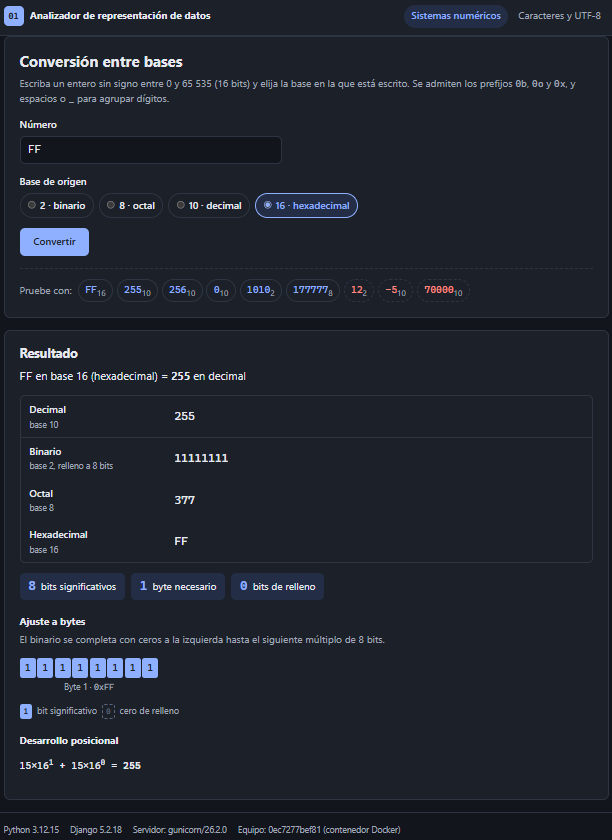
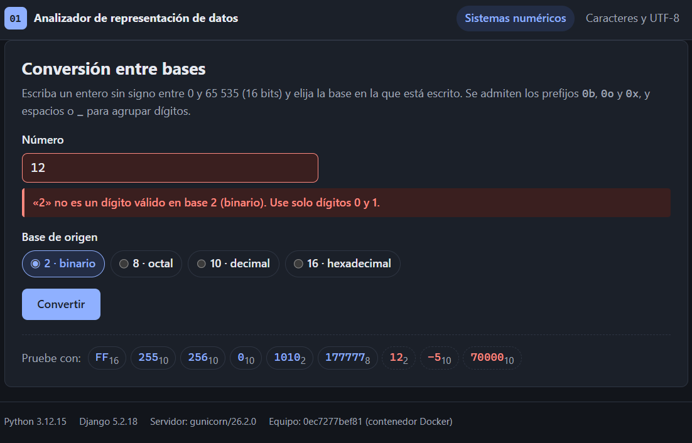
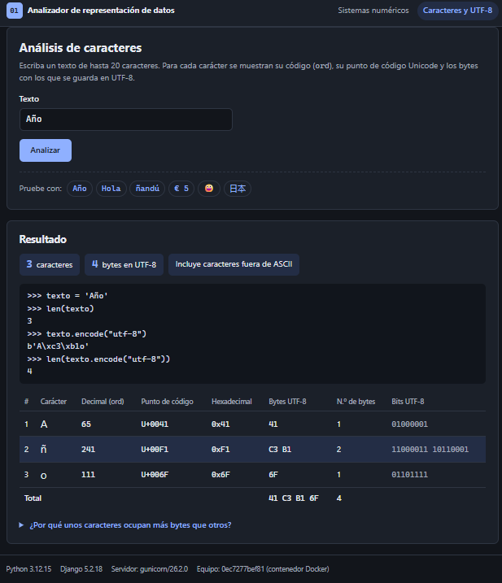
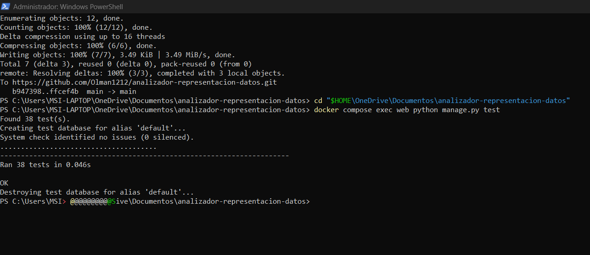
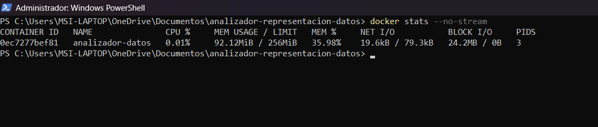
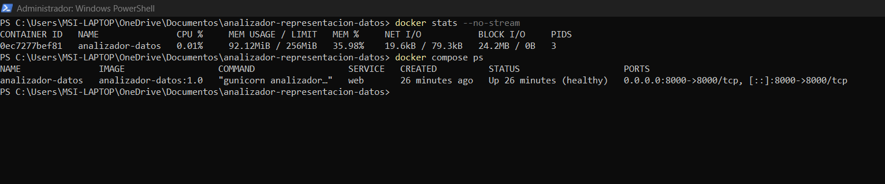

# Analizador de representación de datos

Aplicación web hecha con **Python 3.12 y Django** que relaciona tres temas del curso de arquitectura y organización de computadores:

- **Sistemas numéricos**: convierte un entero de 0 a 65 535 entre las bases 2, 8, 10 y 16, rellena el binario hasta bytes completos e indica cuántos bits y bytes necesita.
- **Codificación de caracteres**: para cada carácter de un texto muestra su código (`ord`), su punto de código Unicode (`U+XXXX`), su valor hexadecimal y sus bytes en UTF-8.
- **Ejecución en contenedores**: se sirve con gunicorn dentro de un contenedor Docker limitado a 256 MB de RAM y 1 CPU.

Toda la interfaz, los mensajes de error y esta documentación están en español.

**Video de demostración (máximo 2 minutos):** [ver en Google Drive](https://drive.google.com/file/d/1OqX-Wfhepzw1Wsqf6RQlzwY_TDkvaK8n/view?usp=sharing)

## Contenido

1. [Estructura del proyecto](#1-estructura-del-proyecto)
2. [Funcionamiento](#2-funcionamiento)
3. [Ejecución en local](#3-ejecución-en-local)
4. [Pruebas automatizadas](#4-pruebas-automatizadas)
5. [Docker y Docker Compose](#5-docker-y-docker-compose)
6. [Evidencias](#6-evidencias)
7. [Arquitectura de Von Neumann en la app](#7-arquitectura-de-von-neumann-en-la-app)
8. [Por qué el contenedor comparte el kernel del host](#8-por-qué-el-contenedor-comparte-el-kernel-del-host)
9. [Guion del video (máximo 2 minutos)](#9-guion-del-video-máximo-2-minutos)
10. [Correspondencia con la rúbrica](#10-correspondencia-con-la-rúbrica)

---

## 1. Estructura del proyecto

```text
.
├── analizador/                   Proyecto Django (configuración)
│   ├── settings.py               Ajustes; los sensibles se leen de variables de entorno
│   ├── urls.py                   Rutas raíz: incluye la app y redirige /favicon.ico
│   ├── wsgi.py                   Punto de entrada que usa gunicorn
│   └── asgi.py
├── representacion/               App principal
│   ├── converters.py             Lógica pura: bases, bytes y UTF-8 (no depende de Django)
│   ├── forms.py                  ConversionForm y TextoForm (forms.Form con clean_* y clean)
│   ├── views.py                  Vistas conversion_numerica y analisis_texto
│   ├── urls.py                   /  y  /texto/
│   ├── context_processors.py     Python, Django, servidor y equipo para el pie de página
│   ├── models.py                 Vacío: la app no guarda datos
│   ├── templates/representacion/
│   │   ├── base.html             Plantilla común: cabecera, navegación y pie
│   │   ├── numeros.html          Formulario y resultado de la conversión
│   │   └── texto.html            Formulario y tabla de caracteres
│   ├── static/representacion/
│   │   ├── estilos.css           CSS simple con modo claro y oscuro
│   │   └── favicon.svg
│   └── tests/
│       ├── test_converters.py    Lógica de conversión, por separado de las vistas
│       ├── test_formularios.py   Errores que produce cada formulario
│       └── test_vistas.py        Vistas con el cliente de pruebas de Django
├── docs/evidencias/              Capturas para la entrega
├── manage.py
├── requirements.txt              Dependencias con versiones fijas
├── Dockerfile                    Imagen basada en python:3.12-slim, usuario sin privilegios
├── compose.yaml                  Puerto 8000, 256 MB de RAM y 1 CPU
├── .dockerignore
└── .gitignore
```

Dependencias (`requirements.txt`): Django 5.2.18 (versión LTS, con soporte hasta abril de 2028), gunicorn 26.2.0 y WhiteNoise 6.12.0, que sirve el CSS cuando la app corre con gunicorn.

## 2. Funcionamiento

### Recorrido de una petición

```text
Navegador ──GET /?numero=FF&base=16──▶ gunicorn ──▶ Django (urls.py)
   ▲                                                    │
   │                                       views.conversion_numerica
   │                                                    │
   │                                   ConversionForm.clean_numero / clean
   │                                                    │
   │                                     converters.convertir("FF", 16)
   │                                                    │
   └────────────── HTML (numeros.html) ◀── plantilla con el resultado
```

Los formularios usan **GET** porque la operación no cambia nada en el servidor; así cada resultado tiene su propia URL (`/?numero=FF&base=16`, `/texto/?texto=Año`), útil para repetir pruebas.

La lógica está en `representacion/converters.py`, que no importa Django. Los formularios solo traducen sus errores (`ErrorValidacion`) a errores de Django, de modo que las reglas no se duplican y se pueden probar por separado.

### Conversiones y ajuste a bytes

- **A decimal (método de Horner)**: `«1A»` en base 16 → `(0·16 + 1)·16 + 10 = 26`.
- **Desde decimal (divisiones sucesivas)**: se divide entre la base y los restos, leídos del último al primero, son los dígitos.
- **Bits significativos**: `max(1, valor.bit_length())`. Por convención, el 0 ocupa 1 bit.
- **Bytes necesarios**: bits divididos entre 8, redondeando hacia arriba.
- **Binario relleno**: se completan ceros a la izquierda hasta `bytes × 8` bits.

| Entrada | Decimal | Binario relleno | Octal | Hex | Bits sig. | Bytes |
|---|---|---|---|---|---|---|
| `0` (base 10) | 0 | `00000000` | 0 | 0 | 1 | 1 |
| `FF` (base 16) | 255 | `11111111` | 377 | FF | 8 | 1 |
| `256` (base 10) | 256 | `00000001 00000000` | 400 | 100 | 9 | 2 |
| `177777` (base 8) | 65535 | `11111111 11111111` | 177777 | FFFF | 16 | 2 |

La página también dibuja los bits de cada byte, distinguiendo los significativos de los ceros de relleno, y muestra el desarrollo posicional (`15×16¹ + 15×16⁰ = 255`).

Los algoritmos se programaron a mano para que se vea el método; las pruebas comprueban que dan lo mismo que `int()` y `format()` de Python.

Se aceptan minúsculas, el prefijo propio de la base (`0b`, `0o`, `0x`) y espacios o `_` para agrupar dígitos (`1111 0000`, `FF_FF`).

### Validación y mensajes de error

| Caso | Ejemplo | Mensaje |
|---|---|---|
| Entrada vacía | *(nada)* | La entrada está vacía. Escriba un número. |
| Dígito inválido para la base | `12` en base 2 | «2» no es un dígito válido en base 2 (binario). Use solo dígitos 0 y 1. |
| Valor negativo | `-5` | No se admiten valores negativos («-5»). Escriba un número entre 0 y 65 535. |
| Fuera de rango | `70000` | «70000» en base 10 equivale a 70 000, que está fuera de rango: el valor debe estar entre 0 y 65 535 (16 bits sin signo). |
| Base no permitida | `base=7` en la URL | La base «7» no es válida. Elija 2, 8, 10 o 16. |
| Texto vacío | *(nada)* | El texto está vacío. Escriba al menos un carácter. |
| Texto demasiado largo | 21 caracteres | El texto tiene 21 caracteres y el máximo es 20. Acórtelo e inténtelo de nuevo. |

Los dígitos se validan carácter a carácter en lugar de confiar en `int()`, porque `int("١٢")` (dígitos arábigos) o `int("１２")` (dígitos de ancho completo) devuelven 12 sin error.

### Caracteres y UTF-8

Para cada carácter se muestra:

| Carácter | `ord` | Punto de código | Hexadecimal | Bytes UTF-8 | Bits UTF-8 |
|---|---|---|---|---|---|
| `A` | 65 | U+0041 | 0x41 | `41` | `01000001` |
| `ñ` | 241 | U+00F1 | 0xF1 | `C3 B1` | `11000011 10110001` |
| `€` | 8364 | U+20AC | 0x20AC | `E2 82 AC` | 3 bytes |
| `😀` | 128512 | U+1F600 | 0x1F600 | `F0 9F 98 80` | 4 bytes |

`len("Año")` es **3** porque Python cuenta puntos de código, pero `"Año".encode("utf-8")` ocupa **4** bytes (`41 C3 B1 6F`): la `ñ` (U+00F1, 11 bits significativos) no cabe en un byte y UTF-8 la reparte en `110 00011` + `10 110001`.

Nota: los caracteres que el usuario ve como uno solo pero están formados por varios puntos de código (por ejemplo, un emoji con modificador de tono de piel) cuentan como varios caracteres, igual que en `len()`.

## 3. Ejecución en local

Requisitos: Python 3.12 (la versión de la imagen Docker). El proyecto también se probó con Python 3.13; si es la que tiene instalada, use `py -3.13` en el primer comando.

En Windows (PowerShell):

```powershell
py -3.12 -m venv .venv
.\.venv\Scripts\Activate.ps1
pip install -r requirements.txt
python manage.py test
python manage.py runserver
```

Si PowerShell no deja ejecutar `Activate.ps1`, se puede usar el intérprete del entorno sin activarlo: `.\.venv\Scripts\python.exe manage.py runserver`.

En Linux o macOS:

```bash
python3.12 -m venv .venv
source .venv/bin/activate
pip install -r requirements.txt
python manage.py test
python manage.py runserver
```

Después se abre <http://127.0.0.1:8000/>. No hace falta `migrate`: la app no tiene modelos ni guarda datos.

Variables de entorno opcionales:

| Variable | Valor por defecto | Uso |
|---|---|---|
| `DJANGO_DEBUG` | `1` | `0` desactiva el modo depuración (así corre en Docker). |
| `DJANGO_ALLOWED_HOSTS` | `localhost,127.0.0.1,[::1]` | Nombres de host aceptados, separados por comas. |
| `DJANGO_SECRET_KEY` | clave de desarrollo | Debe cambiarse si la app se publica. |

## 4. Pruebas automatizadas

```powershell
python manage.py test -v 2
```

Hay **38 pruebas** (`django.test.TestCase`) en tres archivos:

| Requisito | Prueba |
|---|---|
| Conversiones válidas (FF₁₆ → 255, 11111111, 377) | `test_converters.ConversionesValidasTests.test_hexadecimal_ff_en_las_cuatro_bases`, `test_vistas.VistaNumerosTests.test_conversion_valida` |
| Relleno a byte: 255 → 8 bits, 256 → 16 bits, 0 → 8 bits | `test_255_ocupa_8_bits_y_256_ocupa_16`, `test_cero_se_muestra_con_8_bits`, `test_vistas…test_256_se_muestra_con_16_bits` |
| El algoritmo coincide con `int()` y `format()` | `test_coincide_con_las_funciones_de_python` (60 combinaciones) |
| Dígito inválido para la base | `test_digito_invalido_para_la_base`, `test_digitos_unicode_no_se_aceptan`, `test_vistas…test_error_de_digito_invalido` |
| Fuera de rango | `test_valor_fuera_de_rango`, `test_vistas…test_error_de_rango` |
| Valor negativo | `test_valor_negativo`, `test_vistas…test_error_valor_negativo` |
| Entrada vacía | `test_entrada_vacia`, `test_vistas…test_error_entrada_vacia` |
| UTF-8 con ñ: «Año» = 3 caracteres, 4 bytes | `test_ano_tiene_3_caracteres_y_4_bytes`, `test_vistas…test_texto_con_enie` |
| Texto vacío o de más de 20 caracteres | `test_texto_vacio`, `test_texto_de_mas_de_20_caracteres` y sus versiones en formularios y vistas |
| Errores asignados al campo correcto | `test_formularios.py` |

Resultado obtenido en local:

```text
Found 38 test(s).
System check identified no issues (0 silenced).
......................................
----------------------------------------------------------------------
Ran 38 tests in 0.055s

OK
```

Dentro del contenedor, con Python 3.12.15, también pasan las 38: `docker compose exec web python manage.py test` (ver la sección 6).

## 5. Docker y Docker Compose

Requisito en Windows: **Docker Desktop con WSL2**. Si `docker version` muestra un error de conexión con `dockerDesktopLinuxEngine`, el motor no está en marcha: abra Docker Desktop. Si WSL no está instalado, ejecute `wsl --install` en una terminal de administrador y reinicie el equipo.

### La imagen

El `Dockerfile`:

- parte de `python:3.12-slim`;
- instala primero las dependencias, para reutilizar esa capa mientras `requirements.txt` no cambie;
- ejecuta `collectstatic` para que WhiteNoise sirva el CSS;
- crea el usuario `app` (UID 10001) y ejecuta la app con él, **no como root**; el código pertenece a root, así que el proceso puede leerlo pero no modificarlo;
- arranca gunicorn en el puerto 8000 con 2 procesos de trabajo (`WEB_CONCURRENCY=2`) y sin su socket de control (`--no-control-socket`), que la app no usa y que necesitaría un directorio personal;
- ocupa 242 MB en disco (52 MB comprimida);
- define un `HEALTHCHECK` que consulta la página principal cada 30 s.

### Con `docker build` y `docker run`

```powershell
docker build -t analizador-datos:1.0 .
docker run -d --name analizador-datos -p 8000:8000 --memory=256m --cpus=1 analizador-datos:1.0
```

Comprobar los límites que aplicó Docker (memoria en bytes y CPU en milmillonésimas):

```powershell
docker inspect analizador-datos --format "{{.HostConfig.Memory}} {{.HostConfig.NanoCpus}}"
```

Debe mostrar `268435456 1000000000`, es decir, 256 MiB y 1 CPU.

Con solo `--memory`, Docker permite además la misma cantidad en swap. Para impedirlo, añada `--memory-swap=256m`, que es lo que hace `compose.yaml`.

Detener y borrar el contenedor:

```powershell
docker rm -f analizador-datos
```

### Con Docker Compose

```powershell
docker compose up --build -d
docker compose ps
docker compose logs -f web
docker compose exec web python manage.py test
docker compose down
```

`compose.yaml` publica el puerto 8000 y fija los límites de dos formas equivalentes, que `docker compose` comprueba que coincidan:

```yaml
deploy:
  resources:
    limits:
      cpus: "1.0"
      memory: 256M
mem_limit: 256m
cpus: 1.0
memswap_limit: 256m
```

`docker compose config` muestra la configuración ya interpretada: `memory: "268435456"` y `cpus: 1`.

Si antes se lanzó el contenedor con `docker run`, bórrelo (`docker rm -f analizador-datos`) antes de usar Compose, porque los dos usan el mismo nombre.

## 6. Evidencias

Las salidas de texto de esta sección son reales. Se obtuvieron el 18/10/2026 en Windows 11 con Docker Desktop (motor 29.8.2, WSL2). La salida completa de cada comando está en [`docs/evidencias/salidas-docker.txt`](docs/evidencias/salidas-docker.txt), y las capturas de pantalla al final de esta sección.

### Cómo obtener la evidencia de Docker

1. Levante la app: `docker compose up --build -d`.
2. Abra <http://localhost:8000/> y haga una conversión, para que el contenedor tenga algo de actividad.
3. Ejecute:

   ```powershell
   docker stats --no-stream
   ```

   La columna `MEM USAGE / LIMIT` debe terminar en **256MiB**: es el límite del cgroup.

   No sirve como evidencia la pantalla *Containers* de Docker Desktop: su «Container memory usage» (por ejemplo `77.54MB / 7.46GB`) compara el uso con toda la RAM de la VM de WSL2, no con el límite del contenedor. Lo mismo ocurre con la CPU: `/ 1600%` corresponde a los 16 núcleos del equipo, mientras que el contenedor solo puede usar 1 (100 %).

4. Para mostrar el límite desde dentro del contenedor (cgroups v2):

   ```powershell
   docker exec analizador-datos cat /sys/fs/cgroup/memory.max
   docker exec analizador-datos cat /sys/fs/cgroup/cpu.max
   ```

   Deben mostrar `268435456` y `100000 100000`: 100 000 µs de CPU por cada periodo de 100 000 µs, o sea, 1 CPU.

5. Haga una captura de la terminal y guárdela en `docs/evidencias/`.

El pie de cada página muestra la versión de Python, el servidor WSGI y el nombre del equipo. Dentro de Docker aparece `Servidor: gunicorn/26.2.0` y, como nombre del equipo, el ID corto del contenedor, el mismo que muestra `docker ps`, seguido de «(contenedor Docker)». Es una prueba visible de que la página la sirve el contenedor.

### Salidas obtenidas

Con `docker compose up --build -d`:

```text
> docker compose ps
NAME               IMAGE                  COMMAND                  SERVICE   CREATED         STATUS                   PORTS
analizador-datos   analizador-datos:1.0   "gunicorn analizador…"   web       7 seconds ago   Up 6 seconds (healthy)   0.0.0.0:8000->8000/tcp, [::]:8000->8000/tcp

> docker stats --no-stream
CONTAINER ID   NAME               CPU %     MEM USAGE / LIMIT   MEM %     NET I/O           BLOCK I/O   PIDS
0ec7277bef81   analizador-datos   0.01%     78.03MiB / 256MiB   30.48%    4.05kB / 25.7kB   0B / 0B     3

> docker compose exec web cat /sys/fs/cgroup/memory.max /sys/fs/cgroup/cpu.max /sys/fs/cgroup/memory.swap.max
268435456
100000 100000
0

> docker compose exec web python manage.py test
Found 38 test(s).
...
Ran 38 tests in 0.041s

OK
```

Con `docker run … --memory=256m --cpus=1`:

```text
> docker inspect analizador-datos --format "{{.HostConfig.Memory}} {{.HostConfig.NanoCpus}}"
268435456 1000000000

> docker exec analizador-datos id
uid=10001(app) gid=10001(app) groups=10001(app)

> docker stats --no-stream
CONTAINER ID   NAME               CPU %     MEM USAGE / LIMIT   MEM %     NET I/O           BLOCK I/O   PIDS
d725bf3a5baf   analizador-datos   17.26%    76.7MiB / 256MiB    29.96%    2.91kB / 18.6kB   0B / 0B     3
```

Interpretación:

- La app usa unos **77 MiB de los 256 MiB** permitidos (30 %), así que tiene margen.
- **3 procesos** (`PIDS`): el maestro de gunicorn y sus 2 trabajadores.
- El CPU del 17 % con `docker run` corresponde al arranque; en reposo baja al 0.01 %.
- La app corre como el usuario `app` (UID 10001), no como root.
- Con Compose, `memory.swap.max` es 0 porque `memswap_limit` es igual a `mem_limit`. Con `docker run` y solo `--memory`, vale 268435456: otros 256 MiB de swap.
- Las 38 pruebas también pasan dentro del contenedor, con Python 3.12.15.

### Video

[Grabación de la demostración en Google Drive](https://drive.google.com/file/d/1OqX-Wfhepzw1Wsqf6RQlzwY_TDkvaK8n/view?usp=sharing). Sigue el guion de la sección 9: conversión válida (`FF` y `256`), error de validación (`12` en base 2), análisis de «Año», pruebas dentro del contenedor y `docker stats` con el límite de 256 MiB.

### Capturas

Capturas tomadas con la app ejecutándose en el contenedor. El pie de las páginas muestra `gunicorn/26.2.0` y el equipo `0ec7277bef81 (contenedor Docker)`, el mismo ID que aparece en `docker stats`.

**1. Conversión válida.** `FF` en base 16 → 255, `11111111`, 377 y FF; 8 bits significativos, 1 byte y el desarrollo posicional `15×16¹ + 15×16⁰ = 255`.



**2. Error de validación.** `12` en base 2: «"2" no es un dígito válido en base 2 (binario). Use solo dígitos 0 y 1.» No se muestra ningún resultado.



**3. Texto con ñ.** «Año»: 3 caracteres y 4 bytes en UTF-8; la `ñ` es 241, `U+00F1`, `0xF1` y en UTF-8 `C3 B1` (2 bytes).



**4. Pruebas dentro del contenedor.** `docker compose exec web python manage.py test` → `Ran 38 tests`, `OK`.



**5. `docker stats --no-stream`.** `92.12MiB / 256MiB` (36 % del límite), CPU 0.01 % en reposo y 3 procesos.



**6. `docker compose ps`.** El contenedor está `Up 26 minutes (healthy)` y publica el puerto `0.0.0.0:8000->8000/tcp`.



## 7. Arquitectura de Von Neumann en la app

En una máquina de Von Neumann, la CPU ejecuta instrucciones que están en la **misma memoria** que los datos y se comunica con la memoria y la E/S por **buses**. Así usa la app cada recurso:

- **CPU y ALU.** Las conversiones son trabajo de la ALU: en Horner, cada dígito es una multiplicación y una suma (`valor * base + digito`), y las divisiones sucesivas usan `divmod` (cociente y resto). `bit_length()`, el relleno con ceros y la codificación UTF-8 se reducen a desplazamientos, comparaciones y operaciones lógicas (`AND`, `OR`) sobre bits.
- **Unidad de control.** Lleva el contador de programa (PC) y decide qué instrucción sigue: por ejemplo, el salto que repite el bucle de Horner o el que elige la rama de error.
- **Memoria compartida.** En la misma RAM están las instrucciones (el binario del intérprete CPython y el bytecode de Django y de la app) y los datos (la petición HTTP, las cadenas, los enteros, los bytes UTF-8 y el HTML de la respuesta). Esa memoria es la que el cgroup limita a 256 MB.
- **Entrada y salida.** La petición entra por la tarjeta de red y la respuesta sale por ella. El kernel la entrega a gunicorn por un socket TCP, Django interpreta el HTTP y genera el HTML. En el cliente, el teclado y la pantalla son la E/S del usuario.
- **Buses.** El bus de direcciones indica qué posición de memoria se lee o escribe (lo que carga el MAR), el bus de datos transporta el contenido (MBR) y el bus de control indica lectura, escritura o interrupción. La tarjeta de red copia los paquetes a la RAM por DMA y avisa con una interrupción.
- **Ciclo de búsqueda y ejecución, en dos niveles.**
  1. **Hardware:** la CPU repite el ciclo PC → MAR → lectura de memoria → MBR → IR → decodificación → ejecución mientras ejecuta el programa `python`.
  2. **Intérprete:** CPython tiene su propio ciclo: lee una instrucción de bytecode, la decodifica y la ejecuta. Este es el bytecode del bucle de Horner (`a_decimal`), resumido y comentado, obtenido con `python -c "import dis; from representacion.converters import a_decimal; dis.dis(a_decimal)"` en Python 3.13 (en 3.12 cambian algunos nombres):

     ```text
     L1:  FOR_ITER              (to L2)          ← siguiente dígito o salir
          STORE_FAST            caracter
          LOAD_FAST_LOAD_FAST   (valor, base)
          BINARY_OP             (*)              ← multiplicación en la ALU
          LOAD_GLOBAL           DIGITOS
          LOAD_ATTR             index
          LOAD_FAST             caracter
          CALL                  1
          BINARY_OP             (+)              ← suma en la ALU
          STORE_FAST            valor            ← escritura en memoria
          JUMP_BACKWARD         (to L1)          ← la unidad de control cambia el PC
     ```

     Cada una de esas instrucciones se convierte, a su vez, en muchas instrucciones de máquina que pasan por el ciclo del nivel 1.

## 8. Por qué el contenedor comparte el kernel del host

Un contenedor **no es una máquina virtual**: no tiene kernel propio ni hardware emulado. Es un grupo de procesos normales (gunicorn y sus trabajadores) que el kernel del host ejecuta con dos mecanismos:

- **Namespaces (aislamiento: qué ve el proceso).** PID (dentro, gunicorn ve su propio árbol de procesos), red (interfaz y puertos propios; `-p 8000:8000` conecta el puerto del host con el del contenedor), montaje (su propio sistema de archivos, el de la imagen), UTS (su propio nombre de equipo, el ID del contenedor), IPC y cgroup.
- **Cgroups (límites: cuánto puede usar).** `--memory=256m` escribe `268435456` en `memory.max`; si los procesos lo superan, el kernel mata al proceso con el *OOM killer* (código de salida 137). `--cpus=1` escribe `100000 100000` en `cpu.max`; si se pasa de esa cuota, el proceso no muere, el planificador lo frena (*throttling*).

Como las llamadas al sistema de los procesos del contenedor las atiende el mismo kernel, arrancar un contenedor tarda milisegundos y no reserva memoria para un sistema operativo invitado.

**En Windows y macOS** no hay kernel Linux, así que Docker Desktop arranca una **máquina virtual Linux ligera**: en Windows, la de **WSL2**, con un kernel Linux mantenido por Microsoft. Todos los contenedores comparten el kernel de esa única VM: no hay una máquina virtual por contenedor.

Comprobación real en el equipo de desarrollo:

```text
> docker compose exec web uname -r          (el contenedor de la app)
6.18.54.1-microsoft-standard-WSL2
> docker run --rm python:3.12-slim uname -r  (otro contenedor, solo la imagen base)
6.18.54.1-microsoft-standard-WSL2
> wsl -d docker-desktop uname -r            (la VM de WSL2 de Docker Desktop)
6.18.54.1-microsoft-standard-WSL2
```

Los tres muestran el mismo kernel: el de la VM. La imagen `python:3.12-slim` trae las bibliotecas y programas de Debian, pero no un kernel propio.

## 9. Guion del video (máximo 2 minutos)

Antes de grabar: `docker compose up --build -d` y una terminal abierta en la carpeta del proyecto.

| Tiempo | Qué mostrar | Qué decir (resumen) |
|---|---|---|
| 0:00–0:15 | Terminal: `docker compose ps` (contenedor `healthy`). Navegador en <http://localhost:8000/> | «La app corre con gunicorn dentro de un contenedor limitado a 256 MB y 1 CPU». |
| 0:15–0:40 | Conversión válida: `FF` en base 16 → 255, `11111111`, 377. Luego el ejemplo `256` → `00000001 00000000` | «255 cabe en 1 byte; 256 necesita 9 bits, así que se rellena a 16 bits, 2 bytes». |
| 0:40–0:55 | Error de validación: `12` en base 2, luego `-5` o `70000` | «Los dígitos se validan según la base y el valor debe estar entre 0 y 65 535». |
| 0:55–1:20 | Pestaña «Caracteres y UTF-8» con `Año` | «`len` da 3, pero son 4 bytes: la ñ es U+00F1, 0xF1, y en UTF-8 ocupa dos bytes, C3 B1». |
| 1:20–1:40 | Terminal: `docker compose exec web python manage.py test` | «38 pruebas: conversiones, relleno a bytes, errores y UTF-8; todas pasan». |
| 1:40–2:00 | Terminal: `docker stats --no-stream`, señalar `MEM USAGE / LIMIT … / 256MiB`. Pie de la página con el ID del contenedor | «El cgroup limita la memoria; el contenedor comparte el kernel de la VM de WSL2». |

## 10. Correspondencia con la rúbrica

| Criterio | Dónde está |
|---|---|
| Conversiones y ajuste a bytes (2.0) | `converters.py` (`a_decimal`, `desde_decimal`, `binario_relleno`, `bytes_necesarios`); página de sistemas numéricos; sección 2 |
| Análisis de caracteres y UTF-8 (1.5) | `converters.py` (`InfoCaracter`, `analizar_texto`); página «Caracteres y UTF-8»; sección 2 |
| Validación y mensajes de error (1.0) | `converters.py` (`ErrorValidacion`), `forms.py` (`clean_numero`, `clean`, `clean_texto`); tabla de mensajes en la sección 2 |
| Estructura y funcionamiento de Django (1.5) | Proyecto `analizador` + app `representacion`, formularios, vistas, URLs con nombre, plantilla base común, archivos estáticos; sección 1 |
| Pruebas automatizadas (1.0) | `representacion/tests/` (38 pruebas); sección 4 |
| Dockerfile, Compose y límites de recursos (1.5) | `Dockerfile`, `compose.yaml`, `.dockerignore`; secciones 5 y 8 |
| README, explicación técnica y evidencias (1.5) | Este archivo; secciones 6, 7, 8 y 9 |
